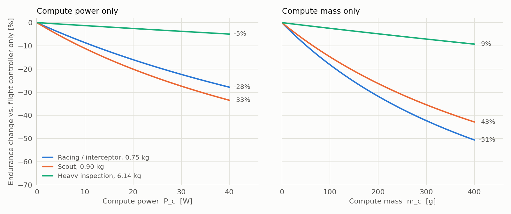
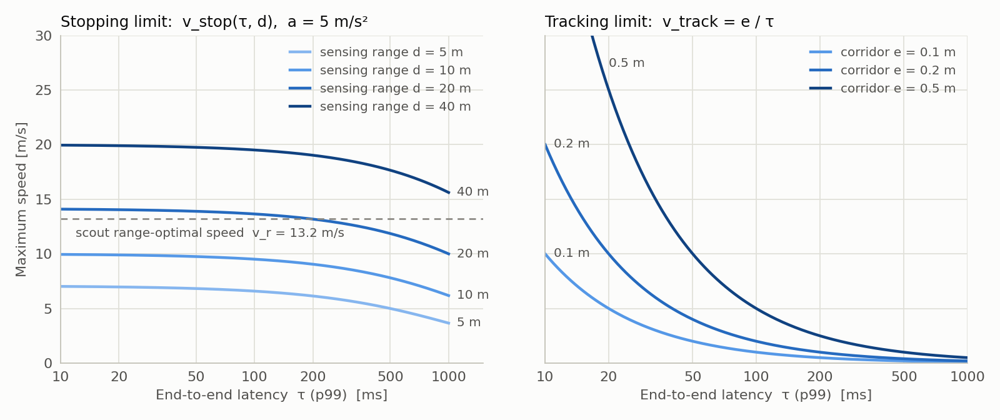
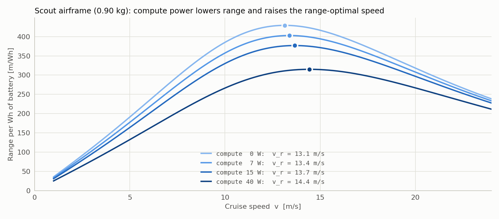
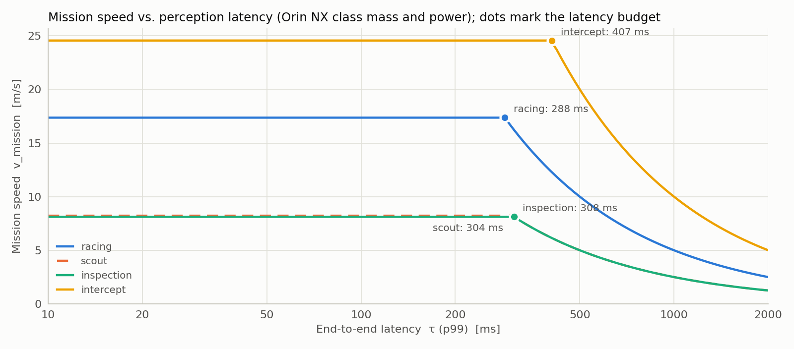

# Benchmark plan: optimal flight speed and the cost of compute

**Status:** proposed
**Source paper:** L. Bauersfeld and D. Scaramuzza, *Range, Endurance, and Optimal Speed Estimates for Multicopters*, IEEE Robotics and Automation Letters, 2022 ([arXiv:2109.04741](https://arxiv.org/abs/2109.04741)).

## The question

Does a more compute-efficient flight computer and flight controller improve the mission capability of a drone? If so, by how much, for which form factor, and through which mechanism?

"Compute efficiency" here means the same perception and estimation work done with less power, less mass, and less latency. "Mission capability" means the speed, range, and endurance a drone can actually use in its mission. This plan covers four form factors: **racing**, **scouting**, **inspection**, and **interception**.

## What the paper gives us

The paper is the best available first-principles method for estimating a multicopter's energy-optimal flight speeds, and it is validated against real flights.

### The model chain

```text
 airframe + propellers ──> BEM aerodynamics ──> shaft power ──> motor model ──> electrical power ──> battery model ──> voltage, energy, time
 (mass, prop radius,       (blade-element      Q·Ω            η_M(Ω), fitted    P_mot(t)            OTC Thevenin circuit,
  rotor count, area)        momentum theory)                   on 44 motor-prop                     fitted on 10 LiPo packs
                                                               pairs
```

| Component | Accuracy reported in the paper |
|---|---|
| BEM aerodynamics | thrust RMSE 0.91 N, on flights up to 65 km/h (18 m/s) |
| Power, simulated vs. measured | 2.5% RMSE on circle flights from 4 to 10 m/s |
| Battery voltage (OTC model) | 43.1 mV per cell (1.3%) on discharge tests, 60.8 mV in flight |

### Two energy-optimal speeds

- **$v_e$, the endurance-optimal speed,** minimizes power: $v_e = \arg\min_v P(v)$. Flying slowly forward uses *less* power than hovering, because of dynamic lift: $P_e / P_h = 0.914$.
- **$v_r$, the range-optimal speed,** minimizes energy per distance: $v_r = \arg\max_v v / P(v)$. On the power curve, this is where a tangent line drawn from the origin touches it: $P_r / P_h = 1.092$.

### The pen-and-paper algorithm (Sec. VII)

From mass $m$, propeller radius $r$, rotor count $N_r$, cell count and capacity, and frontal area $A$:

1. hover induced velocity $v_{i,h} = \sqrt{mg / (2\rho\pi r^2 N_r)}$ and hover power $P_h = (mg)^{3/2} / (\eta_P \sqrt{2\rho\pi N_r}\, r)$, with $\eta_P = 0.6$ as stated (eqs. 4 and 5). Phase 0 found that the paper's results actually correspond to $\eta_P \approx 0.54$; see [Phase 0 results](#phase-0-results).
2. $P_e = 0.914\,P_h$ and $P_r = 1.092\,P_h$ (eq. 17)
3. electrical power $P_{mot} = P / \eta_M$, with $\eta_M = 0.75$
4. per-cell power, then effective capacity from a cubic Peukert-like fit (eq. 21)
5. $t = C_{eff} \cdot 3.7\,\mathrm{V} \cdot N_S \cdot 3600 / P_{mot}$
6. $1/\hat v = c_0 + c_1 v_{i,h} + c_2 A$, with $A$ in cm², and $v = \hat v \cdot v_{i,h}$ (eq. 18, $R^2 \approx 0.97$)
7. range $x_r = v_r t_r$

The paper's six commercial drones (Table III) come out within about 10% of the manufacturers' figures.

**Reproduction check.** Our implementation reproduces the paper's Mavic 3 worked example to within 0.6% at every step, and all six drones in Table III to within 7%, once $\eta_P$ is calibrated to 0.54. With the stated 0.6, it overestimates endurance and range by 4 to 17%. Details are in [Phase 0 results](#phase-0-results).

### What the paper leaves out, and why it matters here

> "The power consumption of the flight controller and potentially the onboard computer is neglected as it is typically negligible compared to the power consumption of the motors. For example, an NVIDIA Jetson TX2 consumes <10 W while the research platform needs 130 W to hover." (Sec. VII-A)

That assumption is exactly what this benchmark tests. It holds for the paper's 752 g research quad running *motion-capture* state estimation. It stops holding once the drone carries its own perception. The paper also assumes:
- the drone flies at its energy-optimal speed;
- the only limits are aerodynamic and electrochemical;
- straight, steady flight, with no takeoff, landing, or maneuvering.

None of the four target missions fly that way all the time.

## How compute enters mission capability

Compute affects a mission through four channels. The paper's model can carry the first two. The other two set a separate *speed limit*.

| Channel | Mechanism | What it changes |
|---|---|---|
| **1. Power** $P_c$ | adds a constant offset to the power curve | endurance and range, and it shifts $v_r$ |
| **2. Mass** $m_c$ | raises hover power ($P_h \propto m^{3/2}$) and lowers thrust-to-weight | endurance, range, $v_e$ and $v_r$ (through $v_{i,h}$), acceleration and agility |
| **3. Latency** $\tau$ (p99, not the mean) | the drone travels "blind" during $\tau$, and the control loop loses phase | the stopping-limited speed, and the speed at which turns can still be tracked |
| **4. Perception quality** | sensing range $d$, estimation accuracy, detection rate, all bought with compute | the maximum safe speed, and how tight a corridor the drone can hold |

The speed a mission can actually use is the smallest of these limits:

$$v_{mission} = \min\big(\; v_{energy}(P_c, m_c),\;\; v_{stop}(\tau, d, a),\;\; v_{turn}(a, R),\;\; v_{agility}(\tau, R),\;\; v_{max}(T/W) \;\big)$$

where $v_{energy}$ is $v_r$ or $v_e$ depending on what the mission is trying to maximize, and:

- $v_{stop} = a\left(\sqrt{\tau^2 + 2d/a} - \tau\right)$ stops within the sensing range $d$ at deceleration $a$.
- $v_{turn} = \sqrt{a R}$ holds the mission's tightest turn radius $R$ at the available horizontal acceleration $a$, which falls as compute mass lowers thrust-to-weight.
- $v_{agility} = \phi R / \tau$ keeps the phase lost to latency at the turn rate $v/R$ within a budget $\phi$ (0.5 rad).
- $v_{max}$ is the top speed that thrust-to-weight allows.

The first version of this plan used $v_{track} \approx e/\tau$, which keeps the error built up during one latency interval inside a corridor $e$. That bound assumes the stack does not predict its own motion over the latency. With IMU propagation, it doesn't apply, and it made a 60 ms racer look limited to 5 m/s. Phase 1 replaced it with $v_{turn}$ and $v_{agility}$ and keeps $e/\tau$ only as an opt-in worst case. See [Phase 1 results](#phase-1-results).

**The central claim to test:** whenever $v_{stop}$ or $v_{agility}$ is below $v_r$, the drone is speed-limited by its compute, not its energy. In that case, lower latency and longer perception range convert directly into mission speed, and indirectly into range, because flying below $v_r$ costs energy per meter.

### Two analytic results the benchmark should confirm

1. **Compute power does not move the endurance-optimal speed.** A constant offset does not move the curve's minimum, so $v_e$ stays put.
2. **Compute power *raises* the range-optimal speed while reducing range.** Adding $P_c$ lifts the curve, so the tangent from the origin touches it at a higher speed, satisfying $P'(v_r) = (P(v_r) + P_c)/v_r$. A power-hungry flight computer should therefore cruise *faster* to maximize range. If perception can't keep up at that speed, the penalty compounds. The pen-and-paper algorithm can't show this shift, because eq. 18 is fitted without $P_c$. Phase 1 adds it.

### First-order estimates

These come from our implementation of the pen-and-paper algorithm ([`models/pen_and_paper.py`](../../models/pen_and_paper.py)); [`models/compute_scenarios.py`](../../models/compute_scenarios.py) reproduces every table in this section, and [`models/plot_figures.py`](../../models/plot_figures.py) renders the figures. We used eq. 5 hover power with the Phase 0 calibration $\eta_P = 0.54$, airframes taken from the paper, and $P_c$ and $m_c$ added. The compute options are **illustrative**, not measured: module plus carrier plus cooling, over a flight-controller-only baseline. Replacing them with measured values is the point of Phase 2. $v_r$ is not corrected for the shift described in result 2.

| Airframe | Compute option | $P_c / P_{mot,e}$ | Endurance | Range | Thrust-to-weight |
|---|---|---|---|---|---|
| **Racing / interceptor class**: 0.75 kg, 4S 1.8 Ah, 5.1" props ($v_e$ 9.6 m/s, $v_r$ 16.5 m/s) | flight-controller MCU only (0.5 W) | 0.4% | 11.9 min | 9.7 km | ×1.00 |
| | efficient companion (7 W, +40 g) | 4.9% | −13% | −12% | ×0.95 |
| | Orin NX class (15 W, +120 g) | 8.7% | −29% | −27% | ×0.86 |
| | AGX Orin class (40 W, +350 g) | 15.2% | −57% | −54% | ×0.68 |
| **Scout class**: 0.90 kg, 4S 5.0 Ah, Mavic 3 ($v_e$ 7.7 m/s, $v_r$ 13.2 m/s) | flight-controller MCU only | 0.6% | 48.1 min | 31.8 km | ×1.00 |
| | efficient companion | 6.8% | −13% | −11% | ×0.96 |
| | Orin NX class | 12.2% | −28% | −24% | ×0.88 |
| | AGX Orin class | 21.4% | −53% | −47% | ×0.72 |
| **Heavy inspection class**: 6.14 kg, 6S2P 15.3 Ah, Matrice 200 ($v_e$ 3.6 m/s, $v_r$ 5.3 m/s) | flight-controller MCU only | 0.1% | 22.3 min | 5.9 km | ×1.00 |
| | efficient companion | 0.8% | −2% | −1% | ×0.99 |
| | Orin NX class | 1.6% | −5% | −4% | ×0.98 |
| | AGX Orin class | 4.0% | −12% | −10% | ×0.95 |

**Mass costs as much as power.** We split the Orin NX case into its two effects. On the scout airframe, power alone costs 15% of endurance and mass alone costs 17%. On the racing airframe, the split is 12% for power and 21% for mass. The power-only loss is larger than the power fraction (12.2%) because higher current draw also lowers the battery's effective capacity. A benchmark that reports only watts misses half the cost.

<picture>
  <source media="(prefers-color-scheme: dark)" srcset="img/endurance-cost-dark.png">
  
</picture>

*Figure 1. Endurance cost of compute power alone (left) and compute mass alone (right), from `models/plot_figures.py`. At realistic module weights (40 to 120 g per 7 to 15 W), mass costs small airframes about as much endurance as power does; the heavy airframe barely notices either.*

**Latency matters less than sensing range for stopping.** Here is $v_{stop}$ in m/s, at $a = 5$ m/s²:

| Sensing range $d$ | $\tau$ = 20 ms | 50 ms | 100 ms | 200 ms | 500 ms |
|---|---|---|---|---|---|
| 5 m | 7.0 | 6.8 | 6.6 | 6.1 | 5.0 |
| 10 m | 9.9 | 9.8 | 9.5 | 9.0 | 7.8 |
| 20 m | 14.0 | 13.9 | 13.7 | 13.2 | 11.9 |
| 40 m | 19.9 | 19.8 | 19.5 | 19.0 | 17.7 |

<picture>
  <source media="(prefers-color-scheme: dark)" srcset="img/speed-limits-dark.png">
  
</picture>

*Figure 2. The stopping limit is set mainly by sensing range and barely moves with latency below 100 ms (left). The uncompensated tracking limit is inversely proportional to latency (right); Phase 1 found it applies only to stacks that don't predict their own motion over the latency.*

Below about 100 ms, latency costs a few percent of stopping-limited speed. Doubling the reliable sensing range is worth 40% or more. Without latency compensation, latency would matter most for *tracking*, since $v_{track} \approx e/\tau$ is directly proportional to $1/\tau$. Phase 1 showed that IMU propagation removes that limit, and that latency then binds only beyond a budget of a few hundred milliseconds. For a scout, compute buys speed mainly by making longer-range perception affordable within its power, mass, and latency budget.

## Hypotheses by form factor

| Form factor | Capability metric | Expected binding constraint | Hypothesis |
|---|---|---|---|
| **Racing** | lap time, maximum speed through gates | $v_{track}$ (latency, estimation accuracy) and thrust-to-weight | Lower latency and lower compute mass raise speed directly. Compute power matters only through mass and cooling, since races last 2 to 3 minutes. |
| **Scouting** | time to goal and range through unknown clutter | $v_{stop}$ (sensing range, latency) in clutter, $v_r$ in the open | In clutter, $v_{stop} < v_r$, so the scout is compute-limited. An efficient computer that affords longer-range perception raises both speed and range. In the open, compute power and mass cost 11 to 24% of range. |
| **Inspection** | time on station, standoff accuracy, area covered per sortie | endurance near $v_e$ and hover; $v_{track}$ for close standoff | Compute efficiency matters a lot on small inspection drones (Skydio class) and little on heavy ones (Matrice class: −5% for an Orin NX). Latency sets how close and how fast the drone can work near structures. |
| **Interception** | closing speed, miss distance, engagement envelope | guidance-loop latency, thrust-to-weight, top speed | Dash speeds are well beyond the paper's validated envelope. Capability is set by $\tau$ in the tracking loop and by thrust-to-weight. Energy only has to last the engagement window. |

**Phase 1 check** (illustrative inputs; see [Phase 1 results](#phase-1-results)):
- **Racing and interception:** thrust-to-weight binds through the turn limit, and compute mass costs 0.6 to 1.2 m/s per 100 g. Latency does not bind below a budget of 280 to 450 ms, so the latency half of the racing hypothesis is not supported at realistic latencies.
- **Scouting:** the stopping limit stays above the turn and energy limits at 20 m sensing range, and mass and power cost range.
- **Inspection:** the small airframe is turn- or energy-limited, and loses 1.4 to 3.7 minutes on station per 100 g of compute.

## Benchmark plan

### Phase 0: reproduce the paper

**Status: done.** Results are below.

- Implement the pen-and-paper algorithm in `models/` with the coefficients from Table II. (Table I holds the full battery-model coefficients, which Phase 1 needs.)
- Reproduce the paper's Mavic 3 worked example to within 1%, and all six drones in Table III to within the table's rounding.
- Resolve the $\eta_P$ discrepancy in the hover power.
- **Deliverable:** a reference model with a regression test against the paper.
- **Exit criterion:** every number is reproduced, or the deviation is explained.

#### Phase 0 results

The model is [`models/pen_and_paper.py`](../../models/pen_and_paper.py), and the paper's values are in [`models/paper_data.py`](../../models/paper_data.py). The regression tests are in [`models/test_pen_and_paper.py`](../../models/test_pen_and_paper.py); run them with `python3 -m unittest discover -s models`. `python3 models/pen_and_paper.py` prints the comparison below.

**Mavic 3 worked example (Sec. VII-E).** This is the only result the paper gives at full precision. Using the paper's $P_h = 73.5$ W, every intermediate and final value is within 1%: $t_e$ = 2908 s (paper 2909), $t_r$ = 2428 s (2429), $v_e$ = 7.74 m/s (7.75), $x_r$ = 32.0 km (32.1). The largest deviation is $v_r$ = 13.19 m/s against the paper's 13.12 (+0.6%). Eq. 18 with the printed Table II coefficients gives 13.19 even with the paper's rounded $v_{i,h}$ = 4.51 m/s, so the difference is most likely in coefficient rounding.

**The propeller figure of merit is 0.54, not 0.6.** Eq. 5 with the stated $\eta_P = 0.6$ gives $P_h$ = 66.2 W for the Mavic 3, not the paper's 73.5 W; 73.5 W requires $\eta_P = 0.540$. Fitting a single $\eta_P$ to all twelve endurance and range values in Table III gives 0.538. Two independent routes give the same answer, so we conclude the paper's results were computed with $\eta_P \approx 0.54$. The model now defaults to `ETA_P_CALIBRATED = 0.54`, and `ETA_P_STATED = 0.6` stays available.

**Table III** (model at $\eta_P = 0.54$ vs. the paper's printed estimates):

| Drone | Endurance [min] | Range [km] | $v_r$ [km/h] | Endurance at $\eta_P = 0.6$ |
|---|---|---|---|---|
| DJI Mavic 2 | 34.2 vs 33 (+3.5%) | 24.0 vs 24 (−0.2%) | 50.4 vs 51 | +15% |
| DJI Mavic 3 | 48.4 vs 48 (+0.8%) | 32.0 vs 32 (0.0%) | 47.5 vs 48 | +12% |
| DJI Matrice 200 | 22.3 vs 23 (−3.0%) | 5.9 vs 6.2 (−4.2%) | 19.2 vs 19 | +8% |
| DJI Matrice 600 Pro | 18.7 vs 18 (+4.0%) | 5.0 vs 5.4 (−6.7%) | 19.4 vs 20 | +16% |
| Parrot Anafi AI | 31.3 vs 31 (+1.1%) | 23.0 vs 23 (−0.1%) | 52.8 vs 53 | +13% |
| Skydio 2 | 27.4 vs 26 (+5.4%) | 18.9 vs 18 (+4.8%) | 49.6 vs 49 | +17% |

- **Speeds reproduce exactly.** Every $v_r$ is within the table's 1 km/h print rounding. Eq. 18 doesn't depend on $\eta_P$, so this checks the speed model independently.
- **Endurance and range are within 7%,** but not within print rounding (about ±2% for whole minutes). No single $\eta_P$ removes the residuals: the Matrice 600 Pro's endurance needs $\eta_P \approx 0.52$ while its range needs about 0.58. The paper's Table III inputs are themselves rounded (mass to 10 g, propeller radius to 1 mm), and the paper may have used per-drone values it doesn't print. We treat ±7% as the model's reproduction accuracy for Table III, and the test suite holds it to 8%.
- **Consequence for this plan:** the estimate tables and figures above use $\eta_P = 0.54$. Absolute endurance and range dropped about 10% from the earlier 0.6 version. The *relative* cost of compute barely changed (Orin NX on the scout: −28% instead of −29%), so none of the conclusions moved.

**What carries into Phase 1:** the full $P(v)$ curve and the $v_r$ shift from $P_c$; the full battery model (Table I); and replacing the paper's airframes with each mission repo's own reference airframe.

### Phase 1: add compute to the model

**Status: done.** Results are below.

- Add $P_c$ and $m_c$ to the power model and propagate them through the battery model.
- Build a full power-versus-speed curve $P(v)$, so we can compute the $v_r$ shift from $P_c$. Two candidate sources:
  - the paper's BEM simulator / NeuroBEM, if available;
  - a momentum-theory-plus-drag curve calibrated to the paper's anchor points ($P_h$, $P_e$ at $v_e$, $P_r$ at $v_r$).
- Add the speed limits, and output $v_{mission}$ together with the constraint that binds it.
- **Deliverable:** an estimator that produces, for each airframe and compute option: $v_e$, $v_r$, $v_{mission}$, endurance, range, thrust-to-weight, and the binding constraint.

#### Phase 1 results

**Code.**
- [`models/power_curve.py`](../../models/power_curve.py): the $P(v)$ surrogate, optimal speeds with compute power, top speed, and maneuvering acceleration.
- [`models/mission.py`](../../models/mission.py): the speed limits, $v_{mission}$, the latency budget, and sensitivities.
- [`models/estimate.py`](../../models/estimate.py): the command-line estimator, `python3 models/estimate.py --help`.
- Inputs in [`models/data/`](../../models/data/): airframes, compute options, and mission profiles.
- Tests in [`models/test_phase1.py`](../../models/test_phase1.py), run with the Phase 0 suite (28 tests in total).

**The power curve.** The paper's BEM code is not published; only its flight dataset is ([NeuroBEM](https://rpg.ifi.uzh.ch/NeuroBEM.html)). We therefore built a two-parameter surrogate, $P(v)/P_h = u(kx) + D x^3$ with $x = v/v_{i,h}$:
- $u$ is the momentum-theory (Glauert) induced-inflow ratio, and the inflow scale $k$ absorbs dynamic lift that momentum theory misses.
- $D x^3$ is parasite drag power.
- $k$ and $D$ are fitted per airframe by least squares to the four pen-and-paper anchor conditions. A wider family with profile-power terms was tried, and the fit drove those terms to zero.
- Pure momentum theory ($k = 1$) can't reproduce the anchors: on a Matrice-class drone it can lower power by at most 7.3% at $v_e$, while the paper's model needs 8.6%.

Against the Phase 0 model, across Table III:
- the fitted $v_e$ and $v_r$ are within 3.4% of eq. 18;
- endurance and range are within 1% on small airframes, and within 5.5% on Matrice-class airframes, where the paper's curve dips deeper than any momentum-theory shape can.

**Both analytic results are confirmed** (scout airframe, compute power only):

| $P_c$ | $v_e$ | $v_r$ | Range at the new $v_r$ | Range at the old $v_r$ |
|---|---|---|---|---|
| 0 W | 7.97 m/s | 13.14 m/s | 31.8 km | 31.8 km |
| 7 W | 7.97 m/s | 13.39 m/s (+2%) | 29.8 km | 29.8 km |
| 15 W | 7.97 m/s | 13.66 m/s (+4%) | 27.9 km | 27.8 km |
| 40 W | 7.97 m/s | 14.44 m/s (+10%) | 23.3 km | 23.0 km |

- **$v_e$ does not move.**
- **$v_r$ rises with compute power.**
- **The range optimum is flat:** cruising at the re-optimized speed recovers only about 1% of range at 40 W. The shift matters less for range itself than for which speed limit binds, since a power-hungry scout wants to fly faster than its perception may allow.

<picture>
  <source media="(prefers-color-scheme: dark)" srcset="img/range-shift-dark.png">
  
</picture>

*Figure 3. Range per Wh of battery versus cruise speed at four compute powers, for the scout airframe with mass held fixed. Dots mark the range-optimal speed. This is the curve Phase 5 measures in flight.*

**The tracking limit was wrong, and two limits replace it.** The plan's $v_{track} = e/\tau$ assumes the stack can't predict its own motion over the latency. Any estimator with IMU propagation does, so that bound made a racer with 60 ms latency look limited to 5 m/s. Latency instead costs control-loop phase at the turn rate $v/R$, which gives $v_{agility} = \phi R / \tau$. The same turn radius brings in a limit that has nothing to do with latency: $v_{turn} = \sqrt{a R}$, which falls as compute mass lowers thrust-to-weight. $e/\tau$ stays available as a worst case (`uncompensated_latency` in a mission profile).

**Estimates with the illustrative compute options.** These are from `python3 models/estimate.py`. The mission value is speed for racing and interception, range for scouting, and time on station for inspection.

| Mission | Compute | T/W | $v_{mission}$ | Binding | Mission value | Latency budget | Per +100 g |
|---|---|---|---|---|---|---|---|
| Racing (rp1) | efficient companion | 4.86 | 18.1 m/s | $v_{turn}$ | 18.1 m/s | 277 ms | −0.88 m/s |
| | Orin NX class | 4.51 | 17.4 m/s | $v_{turn}$ | 17.4 m/s | 288 ms | −0.79 m/s |
| | AGX Orin class | 3.72 | 15.7 m/s | $v_{turn}$ | 15.7 m/s | 319 ms | −0.61 m/s |
| Scout (0.9 kg) | efficient companion | 2.40 | 8.6 m/s | $v_{turn}$ | 22.0 km | 289 ms | −4.1 km |
| | Orin NX class | 2.21 | 8.2 m/s | $v_{turn}$ | 17.4 km | 304 ms | −3.0 km |
| | AGX Orin class | 1.80 | 7.2 m/s | $v_{turn}$ | 9.9 km | 348 ms | −1.4 km |
| Inspection (small) | efficient companion | 2.37 | 8.4 m/s | $v_{energy}$ | 24.0 min | 297 ms | −3.7 min |
| | Orin NX class | 2.16 | 8.1 m/s | $v_{turn}$ | 19.7 min | 308 ms | −2.8 min |
| | AGX Orin class | 1.72 | 6.9 m/s | $v_{turn}$ | 12.3 min | 360 ms | −1.4 min |
| Intercept (rp1) | efficient companion | 4.86 | 25.6 m/s | $v_{turn}$ | 25.6 m/s | 391 ms | −1.24 m/s |
| | Orin NX class | 4.51 | 24.6 m/s | $v_{turn}$ | 24.6 m/s | 407 ms | −1.12 m/s |
| | AGX Orin class | 3.72 | 22.2 m/s | $v_{turn}$ | 22.2 m/s | 451 ms | −0.86 m/s |

The flight-controller-only option is infeasible for all four missions, because each needs onboard perception.

**The latency budget is the main Phase 1 finding.** The latency budget is the largest latency at which no latency limit binds yet. Below it, a faster perception pipeline doesn't raise mission speed at all; only lighter or lower-power compute does. For every mission and compute option here, the budget is 280 to 450 ms. That is far above the 20 to 60 ms the illustrative compute options deliver, so in this model:
- **Mass is the binding compute channel for speed.** It lowers thrust-to-weight, which lowers the turn and braking limits: −0.6 to −1.2 m/s per 100 g for racing and interception.
- **Power and mass together set range and endurance:** −1.4 to −4.1 km of scout range per 100 g, and −0.05 to −0.2 km per watt.
- **Latency matters only past the budget.** Above it, mission speed falls steeply (Figure 4).

<picture>
  <source media="(prefers-color-scheme: dark)" srcset="img/latency-budget-dark.png">
  
</picture>

*Figure 4. Mission speed versus perception latency with Orin NX class mass and power. Each mission's speed is flat until its latency budget (dots), then falls. Scout (dashed) and inspection nearly coincide.*

For a drone designer, this reframes the hypotheses: below the budget, buy lighter and lower-power compute rather than faster compute.

**These results depend on placeholder inputs.** The binding constraint is $v_{turn}$ almost everywhere, which makes the mission turn radii the most influential assumption: 10 m racing, 5 m scouting and inspection, 20 m interception. They are placeholders, as are the thrust-to-weight of the paper-derived airframes and every compute latency. The latency budget is more robust than the binding constraint, because it scales with $R/v$ and $d/v$, not with the absolute speeds.

Other caveats:
- $v_{max}$ uses a quadratic drag coefficient, from `rp1.yaml` for rp1 and derived from the fitted $D$ for the other airframes, at speeds beyond the BEM model's validated 18 m/s.
- In this steady-flight model, the turn limit applies to the whole flight. Phase 4 simulation is where mixed straight and turning segments get scored.

**Deferred:**
- **The full battery model (Table I) moves to Phase 4.** Steady flight is fully served by the eq. 21 effective-capacity fit, and the Table I model only matters for non-constant power profiles. Its units also need resolving first: as printed, $U_0(E_{cell})$ doesn't reach 3.5 V at a plausible per-cell energy unless $E_{cell}$ is in kJ/Ah, and the internal-resistance fit grows with cell capacity, which contradicts LiPo behaviour.
- **Mission-repo airframes:** only racing-drone has one (`rp1`). Its battery, propeller size, and frontal area are placeholders here, because `rp1.yaml` doesn't define them. scout-drone copies `rp1`, and inspection-drone and interceptor-drone have no vehicle yet, so their airframes come from the paper's Table III drones.

### Phase 2: measure the compute

For each target (STM32 F4/F7/H7 flight controllers, efficient companions such as Dragonwing / Ventuno Q, Jetson Orin NX and AGX, Intel embedded), run the L1 pipeline for each form factor:

| Form factor | L1 pipeline |
|---|---|
| Racing | gate detection, then state estimation, then MPC |
| Scouting | stereo or monocular depth, then mapping, then local planner |
| Inspection | VIO, then standoff estimation, then position control |
| Interception | detector and tracker, then guidance law |

For each, record:
- **Latency:** the end-to-end distribution (p50/p99/max), under concurrent load.
- **Power:** the average power and the power trace at mission rate.
- **Mass:** weigh the module, carrier, cooling, and cabling. Don't take the datasheet's module mass.
- **Perception quality:** sensing range or detection range at the operating point.

**Deliverable:** measured ($\tau$, $P_c$, $m_c$, $d$) for each target, which replace the illustrative values above.

#### Phase 2 harness

The measurement harness is in `bench/`. The first two targets are measured (see [Phase 2 results](#phase-2-results-first-two-targets)); masses are not yet weighed.

**What is built:**

| Piece | What it does |
|---|---|
| `bench/pipelines/` | L1 stand-in pipelines for racing (60 Hz), scouting (30 Hz) and inspection (30 Hz), each a chain of timed stages built from off-the-shelf parts with the right compute shape |
| `bench/make_detector.py` | Generates the racing pipeline's detector: a YOLOv8n-shaped network (2.6 M parameters, 0.87 GMACs at 320 px) with random weights |
| `bench/run.py` | Runs one pipeline at mission rate, with other pipelines or CPU stress as concurrent load; records the latency distribution, per-stage timings, dropped frames, power and temperatures |
| `bench/power.py` | Power sampling: Jetson INA3221 rails (Orin and the original Nano layouts), Intel RAPL, any sysfs power file, or an external logger's CSV |
| `bench/to_compute.py` | Combines a target's results with a weighed-mass record (`bench/data/mass/`) into a `models/data/compute.json` entry |

**How the model uses the measurements.** Each mission names its pipeline in `missions.json`, and the mission model then uses that pipeline's measured latency and power. The option-wide `latency_s` and `p_compute` become the worst case over the pipelines.

**Latency definition.** End-to-end latency runs from the frame's capture timestamp to the end of the last stage, so it includes queueing when the pipeline falls behind. It excludes exposure, readout, the ISP and transport to the flight controller; add those with `--latency-extra-ms`. A result that drops more than 1% of frames is rejected: that pipeline doesn't keep up at mission rate on that target.

**The stand-ins measure cost, not quality.** The detector has random weights and the inputs are synthetic, so the harness can't measure the perception-quality column ($d$, detection range). That needs the mission repos' real stacks and data.

**Interception has no pipeline.** The mission model keeps its Phase 1 interception profile with illustrative compute values.

**Harness check on the development desktop** (i7-12700K, CPU only, the other two pipelines as background load, no power reading because RAPL is root-only). This is not a flight target; it only shows the harness works:

| Pipeline | Rate | p50 | p99 | Dropped | Dominant stage |
|---|---|---|---|---|---|
| Racing | 60 Hz | 5.5 ms | 6.2 ms | 0% | detector, 4.4 ms |
| Scouting | 30 Hz | 56 ms | 73 ms | 14% | SGBM stereo, about 31 ms unloaded |
| Inspection | 30 Hz | 6.3 ms | 7.7 ms | 0% | VIO back end and plane fit |

Even on a desktop CPU under load, the scouting pipeline doesn't keep up at 30 Hz. On embedded targets, stereo has to run on the GPU or a hardware stereo engine. Measuring it on the CPU would bury the comparison under a choice of implementation.

**Running it on a target:**

```sh
python3 bench/make_detector.py                         # on a machine with torch; copy bench/assets/ to the target
python3 bench/run.py --pipeline racing --target orin-nx-15w --power jetson --soak 300 \
    --background scout --notes "15 W mode, stock heatsink, open air"
cp bench/data/mass/TEMPLATE.json bench/data/mass/orin-nx-15w.json   # weigh every item
python3 bench/to_compute.py --target orin-nx-15w --mass bench/data/mass/orin-nx-15w.json \
    --latency-extra-ms 15 bench/results/orin-nx-15w/*.json --write
```

On the targets, the harness needs Python 3.6 or later, numpy and OpenCV; onnxruntime is optional, and the detector falls back to OpenCV's dnn module without it. Accelerated runs select the backend with `--provider tensorrt` or `--provider qnn` (detector) and `--stereo vpi-cuda` (scouting stereo).

#### Phase 2 results: first two targets

Two boards, each measured twice in one software environment: once on the CPU only, and once with the accelerator. Every run is 60 s at mission rate after a 60 s soak, open air, stock fan.

- **Jetson Orin Nano Super** dev kit, JetPack 6.2.1, nvpmodel 25 W. Accelerated set: detector on TensorRT 10.3 FP16, stereo on VPI CUDA. Measured under the default DVFS governor, and again with `jetson_clocks` (CPU 1344 MHz, GPU 918 MHz pinned).
- **Arduino Ventuno Q** (Qualcomm Monaco, Hexagon HTP V75), Ubuntu 24.04. Accelerated set: detector on the NPU through onnxruntime-qnn (FP16, QAIRT 2.49). Stereo stays on the CPU: there is no Qualcomm stereo backend in the harness yet.

Each cell is the achieved rate and the p99 end-to-end latency; **bold** keeps up at mission rate (under 1% dropped).

Alone:

| Target, set | Racing (60 Hz) | Scouting (30 Hz) | Inspection (30 Hz) | Idle [W] |
|---|---|---|---|---|
| Orin Nano 25 W, CPU | 27.1 Hz, 54 ms | 7.0 Hz, 175 ms | **30 Hz, 28 ms** | 5.3 |
| Orin Nano 25 W, GPU | **60 Hz, 13.5 ms** | 27.8 Hz, 69 ms | **30 Hz, 28 ms** | 5.3 |
| Orin Nano 25 W + jetson_clocks, CPU | 28.8 Hz, 52 ms | 7.1 Hz, 174 ms | **30 Hz, 26 ms** | 7.1 |
| Orin Nano 25 W + jetson_clocks, GPU | **60 Hz, 7.0 ms** | **30 Hz, 16 ms** | **30 Hz, 27 ms** | 7.2 |
| Ventuno Q, CPU | 25.8 Hz, 56 ms | 12.1 Hz, 116 ms | **30 Hz, 24 ms** | 8.6 |
| Ventuno Q, NPU | **60 Hz, 7.7 ms** | 12.1 Hz, 116 ms | **30 Hz, 23 ms** | 8.5 |

With the other two pipelines as concurrent load (the condition the plan asks for). Power is the mean over the three loaded runs, with all three pipelines running:

| Target, set | Racing (60 Hz) | Scouting (30 Hz) | Inspection (30 Hz) | Power [W] |
|---|---|---|---|---|
| Orin Nano 25 W, CPU | 7.4 Hz, 245 ms | 4.5 Hz, 357 ms | 19.8 Hz, 108 ms | 8.3 |
| Orin Nano 25 W, GPU | **60 Hz, 14 ms** | **30 Hz, 41 ms** | **30 Hz, 36 ms** | 9.3 |
| Orin Nano 25 W + jetson_clocks, CPU | 8.2 Hz, 227 ms | 4.1 Hz, 351 ms | 23.0 Hz, 102 ms | 10.4 |
| Orin Nano 25 W + jetson_clocks, GPU | **60 Hz, 7.9 ms** | **30 Hz, 21 ms** | **30 Hz, 33 ms** | 11.3 |
| Ventuno Q, CPU | 10.1 Hz, 153 ms | 6.6 Hz, 272 ms | 17.9 Hz, 109 ms | 14.6 |
| Ventuno Q, NPU | **60 Hz, 14.6 ms** | 11.8 Hz, 117 ms | **30 Hz, 23 ms** | 13.3 |

The per-run tables, with per-stage timings, come from `python3 bench/summarize.py bench/results/<target>...`; the raw results are in `bench/results/`.

**What the measurements say:**

1. **CPU-only companions don't carry the racing pipeline.** Both 8-core ARM CPUs run the 0.87 GMAC detector in 31–36 ms, so racing tops out near 27 Hz alone and 8–10 Hz under load. With the detector on the accelerator, it holds 60 Hz on both boards, under load too: the NPU runs it in 2.8 ms, the GPU in 3.2 ms with pinned clocks (6.9 ms under DVFS).
2. **An accelerator helps the pipelines that don't use it.** Moving the detector off the CPU frees cores for everything else: on the Ventuno, loaded scouting goes from 6.6 to 11.8 Hz and loaded inspection from 17.9 to 30 Hz, though neither touches the NPU.
3. **Scouting needs a stereo engine, not a CPU.** CPU SGBM reaches 7 Hz on the Orin and 12 Hz on the Ventuno. VPI CUDA stereo brings the Orin to 30 Hz. The Ventuno's scouting number is a gap in the harness (no Qualcomm stereo backend), not a hardware limit.
4. **DVFS is part of the target.** Under the default governor at 25 W, the Orin GPU sits at low clock at these loads: racing p99 is 13.5 ms against 7.0 ms pinned, and scouting misses 30 Hz alone (69 ms p99) but makes it under load, when the governor raises the clock. Pinning costs about 1.8 W at idle and 2 W under load. A target in `compute.json` must name its clock policy, as the target names here do.
5. **The two boards' power numbers are not comparable yet.** The Jetson reads VDD_IN, the module input, which excludes the carrier board (5.3 W idle). The Ventuno's INA232 reads the 20 V board input, which includes the fan, the regulators and the peripherals (8.5 W idle). For the mission model, both need the same scope: the power the battery supplies to the whole compute stack, measured with an external logger at the pack.

**Not yet in `compute.json`:** the masses aren't weighed (`bench/data/mass/TEMPLATE.json`), and the camera-to-flight-controller latency the harness doesn't see isn't measured (`--latency-extra-ms`). The pitfalls these runs found are recorded in [#8](https://github.com/branes-ai/drone-capability/issues/8).

### Phase 3: capability cards

Combine Phase 1 and Phase 2 into a capability card for each (form factor, compute option). Each card shows the binding constraint and how much mission capability moves per watt, per gram, and per millisecond.

This phase answers the core question quantitatively. For each form factor:
- How much does moving from compute option X to Y change $v_{mission}$, range, and endurance?
- Which channel (power, mass, latency, or perception quality) is responsible?

### Phase 4: closed-loop simulation (L2)

- Fly mission scenarios in the `anatomy` simulator, injecting the measured latency distributions and power traces. Scenarios:
  - a racing gate course
  - a scout clutter field at several obstacle densities
  - an inspection orbit around a structure
  - an intercept engagement
- Compare the speed actually flown, the collisions, the time to goal, and the energy used against the Phase 3 predictions.
- **Exit criterion:** the predicted $v_{mission}$ is within 10% of the simulated value, and the binding constraint is identified correctly.

### Phase 5: flight validation (proving the optimal speed)

Repeat the paper's validation experiment (Sec. VI-A, Fig. 5): fly constant-speed circles or straight legs at stepped speeds, for example 2 to 16 m/s in 2 m/s steps, while logging pack voltage and current. Plot range per Wh against speed and find where it peaks. That speed is the measured $v_r$.

Run the experiment in four configurations, so each channel is isolated:

| Configuration | Emulates | Purpose |
|---|---|---|
| A: baseline | flight controller only | reproduce the paper's curve on our airframe |
| B: + resistive load at $P_c$ | power only | confirm the predicted upward shift of $v_r$ and the range loss |
| C: + ballast at $m_c$ | mass only | confirm the hover-power and $v_{i,h}$ scaling |
| D: + real flight computer running the L1 pipeline | everything | confirm that B and C add up to D |

- **Airframes:** at least the racing / interceptor class (5-inch) and the scout class.
- **Exit criteria:** the measured $v_r$ is within 10% of prediction, and the measured endurance and range deltas are within 10% of the Phase 3 numbers.

## Instrumentation

- **Pack power:** voltage and current at 100 Hz or more, from the flight controller's power module, checked against an external logger.
- **Compute power:** a separate rail measurement, so $P_c$ is never inferred from the difference between two flights.
- **State:** ground truth from motion capture where available, otherwise RTK GNSS, for speed and tracking error.
- **Wind:** wind speed and direction at the flying site. The paper's correction (eqs. 19 and 20) applies outdoors. Fly indoors or in calm air for Phase 5 B to D.
- **Battery:** pack temperature, and the cycle count per pack. Rotate packs between configurations to control for battery aging.

## Limits and open questions

- **Validity envelope.** The BEM model is validated only up to 18 m/s, and eq. 18 is a regression over the paper's simulated airframes. Racing (more than 30 m/s) and interception dash speeds need the full BEM simulator or new measurements, not the pen-and-paper algorithm. Nano drones (under 50 g) are probably outside the fitted range, and the low Reynolds numbers at that size change propeller efficiency.
- **Steady flight versus missions.** Racing and interception are dominated by transients. Phase 4 has to carry those missions, because their power traces are nothing like steady cruise.
- **Thermal.** A sealed racing or interceptor airframe may throttle a 15 to 40 W module. Latency should be measured at thermal steady state, in a representative enclosure.
- **The paper's model availability.** Is the BEM simulator / NeuroBEM model available to use for Phase 1? If not, which calibrated surrogate do we adopt?
- **Reference airframes.** The airframes here are borrowed from the paper. Each sister mission repo should provide its own reference airframe and compute candidates for Phase 3.
